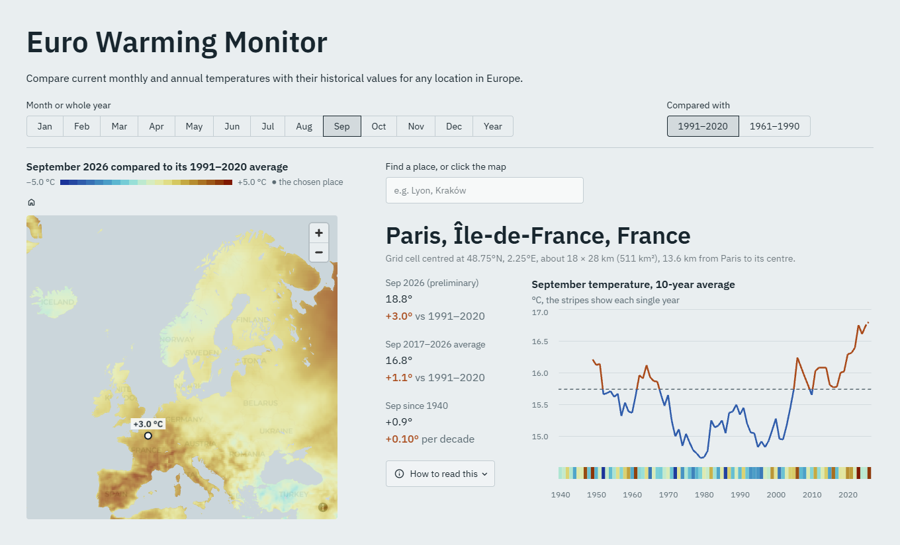
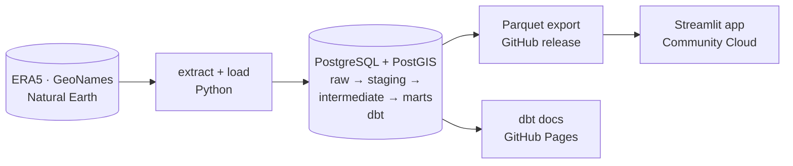

# Euro Warming Monitor

This climate app lets you locate your European city's ERA5 grid cell to compare recent temperatures against historical baselines and visualize local warming trends dating back to 1940.

**Live app: [eurowarmingmonitor.streamlit.app](https://eurowarmingmonitor.streamlit.app/)** · [dbt docs](https://lomska.github.io/EuroWarmingMonitor/) · [data release](https://github.com/lomska/EuroWarmingMonitor/releases/latest)



The project is built as an ELT pipeline: ERA5 reanalysis since 1940 on a 0.25° grid (41,869 grid cells, 43.6 million monthly values) and 75,812 GeoNames places are loaded into PostgreSQL/PostGIS, modelled and tested with dbt, checked in CI, and served by a Streamlit app.

## What the data shows

Over European land, area-weighted, from ERA5 data for 1940–2025:

- **Warming acceleration after the mid-1980s.** The 10-year average over Europe was 7.4 °C in 1940–1949, then 7.6 °C in 1976–1985, then rose to 9.7 °C in 2016–2025.
- **Winter warmed fastest, September slowest.** January (+0.47 °C per decade), March (+0.45) and February (+0.42) lead, against +0.14 °C for September. Winters also vary most from year to year.
- **The Atlantic coast warmed least.** By the largest town in each cell, Ireland (+0.07 °C per decade), Portugal (+0.14) and the United Kingdom (+0.19) warmed least; Norway (+0.41), Belarus (+0.35), Switzerland and Austria (+0.33) most. Warming is also faster in the north: +0.26 °C per decade south of 45° N, +0.30 between 50° N and 70° N.

## How it works



- **Extract**: `extract/` downloads ERA5 monthly 2 m temperature and the land-sea mask from the Copernicus Climate Data Store in ten-year requests, and the GeoNames place lists. Files already on disk are skipped.
- **Load**: `load/` copies new or changed files into the `raw` schema (the ERA5 table is partitioned by decade) and logs every load, so a re-run loads nothing twice.
- **Transform**: dbt builds `staging` views, `intermediate` tables (each grid cell's square and its places, matched with PostGIS) and the `marts` the app reads. The marts have enforced contracts and indexes; the largest fact table builds incrementally. Highlights:
  - `fct_grid_monthly_temp` (43.6 million rows) and `fct_grid_annual_temp` (annual means weighted by days in month),
  - `fct_grid_normals` and `fct_grid_annual_normals`: baseline temperatures from 1991–2020 and 1961–1990,
  - `fct_grid_rolling_10y` and `fct_grid_rolling_10y_annual`: 10-year averages, complete windows only,
  - `mart_grid_latest_period`: the latest occurrence of each month and the latest full year, against both baselines (the map and the numbers),
  - `mart_grid_history`: a view of every year with the 10-year average ending then (the history chart and its stripes).
- **Test**: 77 data tests (generic tests from dbt, dbt-utils and dbt-expectations, and four singular tests), 5 unit tests (complete rolling windows only, day-weighted annual means, the latest year of each month, the history join, and towns on cell borders), and source freshness checks.
- **Serve**: the app reads the marts as a read-only role, or, for the public demo, a Parquet export of them published as a GitHub release. The deployed app downloads the files once when it starts and queries them with DuckDB.
- **Automate**: `pipeline.py` runs any of the steps; GitHub Actions lints everything (ruff, SQLFluff), builds the database image to GHCR, and on every push runs the whole pipeline on a small generated dataset and starts the app on both data sources.

## Run it

**Just the app, on the published data** (Python 3.13, no database):

```bash
git clone https://github.com/lomska/EuroWarmingMonitor.git && cd EuroWarmingMonitor
pip install -r app/requirements.txt
TEMPRADAR_SOURCE=parquet TEMPRADAR_PARQUET=https://github.com/lomska/EuroWarmingMonitor/releases/latest/download streamlit run app/streamlit_app.py
```

On Windows PowerShell, set the two variables first: `$env:TEMPRADAR_SOURCE="parquet"; $env:TEMPRADAR_PARQUET="https://github.com/lomska/EuroWarmingMonitor/releases/latest/download"`.

**The whole pipeline** (Docker, Python 3.13, and a free [Climate Data Store account](https://cds.climate.copernicus.eu) with its API key in `~/.cdsapirc` and the ERA5 licence accepted on the dataset page):

```bash
python -m venv .venv && source .venv/bin/activate   # Windows: .venv\Scripts\activate
pip install -r requirements-dev.txt
cp .env.example .env            # then set the passwords in .env
docker compose up -d            # PostgreSQL + PostGIS with the project's roles and schemas
python pipeline.py all          # extract, load, dbt build and test, docs
streamlit run app/streamlit_app.py
```

The study area and period are in `config/pipeline.yml`. A full dbt build takes about 20 minutes.

**Refreshing the data**, about once a month: move `end_month` in `config/pipeline.yml` forward, then

```bash
python pipeline.py all          # only the new months are downloaded and loaded
python pipeline.py export       # Parquet files in data/app/
python export/publish_release.py   # a new GitHub release, tagged data-YYYY-MM
```

and reboot the deployed app, so it downloads the new release.

## Data and licences

- **Temperatures**: ERA5 monthly averaged reanalysis on single levels, 2 m temperature (Hersbach et al., 2023), Copernicus Climate Change Service (C3S) Climate Data Store, [doi:10.24381/cds.f17050d7](https://doi.org/10.24381/cds.f17050d7), licensed under [CC BY 4.0](https://creativecommons.org/licenses/by/4.0/). The app and the published files contain modified Copernicus Climate Change Service information: the values are converted to °C and turned into per-cell normals, annual and 10-year averages, changes and trends. Neither the European Commission nor ECMWF is responsible for any use of this information.
- **Places**: [GeoNames](https://www.geonames.org), every place with at least 1,000 inhabitants, licensed under [CC BY 4.0](https://creativecommons.org/licenses/by/4.0/).
- **Coastlines and lakes** for the map's sea mask: [Natural Earth](https://www.naturalearthdata.com), 1:50m, public domain.

**Limitations.** ERA5 is a reanalysis: a weather model fitted to observations, not station measurements. Its 2 m air temperature is one average for each 0.25° cell, about 28 km tall and 9–23 km wide in Europe, at the cell's average height, so a town's own value differs, especially in mountains, on coasts and in large cities. The latest two to three months are preliminary (ERA5T) and can be revised slightly. Trends are straight lines through all years since 1940 and say nothing about how steady the warming was.

## Repository

```text
extract/    downloads: ERA5, GeoNames, the sea mask
load/       loading into the raw schema
dbt/        staging, intermediate and marts models, tests, docs
app/        Streamlit app, its charts and data access
export/     Parquet export and GitHub release publishing
ci/         test data and the app check run in CI
perf/       timings and query plans
docker/     database image: PostgreSQL 17, PostGIS 3.6, roles and schemas
docs/       dbt docs (GitHub Pages)
pipeline.py one command for every step
```
